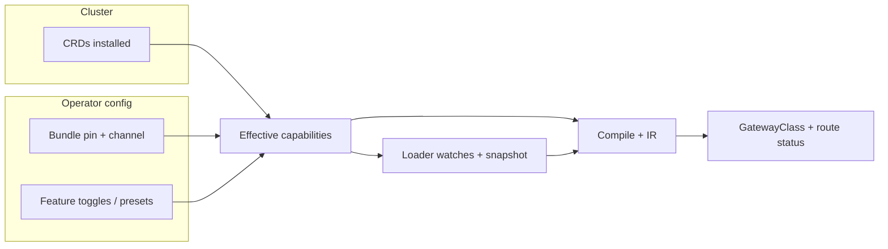

# TODO: Gateway API channel, experimental CRDs, and Extended fields

**Goal:** Define how ugwc selects what it reconciles and what it rejects: **standard vs experimental Gateway API bundles**, **optional CRDs**, and **Extended / experimental fields** on core kinds—without silent drift or duplicated policy across loader, compile, and status.

**Scope (phase 1):** Kubernetes Gateway API (`gateway.networking.k8s.io`) only. Inference Extension (`inference.networking.k8s.io`, `*.x-k8s.io`) comes after this doc is satisfied for Gateway API.

**Non-goals (here):** Replacing cluster admins’ choice of which YAML bundle they install; enforcing bundle purely in controllers without documenting expectations.

---

## 1. Terminology

| Term | Meaning |
|------|---------|
| **Standard / experimental channel** | Gateway API release artifacts (`standard-install.yaml` vs `experimental-install.yaml`). Determines which CRDs exist and which fields appear in schemas for a given release. |
| **Core / Extended** | Conformance *support levels* in the spec (MUST vs optional-for-conformance). Not the same as “experimental channel.” |
| **Experimental CRD** | A resource kind that may exist only in the experimental bundle or as alpha/beta API versions (e.g. historical `TCPRoute`; **`ListenerSet`**, **`TLSRoute`**, **`BackendTLSPolicy`** depending on release—pin rows in §8). |
| **Extended field** | A field on `Gateway`, `HTTPRoute`, etc. that is Extended (or channel-specific), e.g. `Gateway.spec.addresses`, `infrastructure`, `allowedListeners`. |

---

## 2. Three layers (all explicit)

Everything downstream should use a single derived structure **`EffectiveGatewayApiCapabilities`** (name TBD).

| Layer | Meaning | Source |
|-------|---------|--------|
| **A. Cluster facts** | CRDs installed; optional Gateway API bundle annotation on CRDs; stored API versions | Discovery at startup + optional refresh when CRDs change |
| **B. Operator intent** | Which families this deployment may implement (“standard-only”, allow ListenerSet merge, etc.) | Env / JSON file / future `GatewayClass` parameters |
| **C. Implementation** | What this ugwc binary + Praxis/xDS actually implements | Code constants + compile IR coverage |

**Effective capability** = intersection of what the cluster allows, what the operator enables, and what the binary supports. Use this for:

- which watches to register,
- whether snapshot includes optional kinds,
- compile-time accept/reject for fields and kinds,
- `GatewayClass.status.supportedFeatures` (where applicable).

---

## 3. Operator configuration (sketch)

### 3.1 Pin + channel (documentation + validation)

- Expected Gateway API bundle version (e.g. `1.5.0`) for warnings when CRD annotations disagree.
- Declared channel intent (`standard` | `experimental`) for docs and preset defaults.

### 3.2 Feature toggles

Fine-grained flags, preferably aligned with upstream **conformance feature names** where they exist; otherwise ugwc-specific keys.

Example file shape:

```yaml
gateway_api:
  expected_bundle_version: "1.5.0"
  channel: standard

  features:
    gateway_listener_set_merge: false
    route_tls: false          # TLSRoute
    route_grpc: true          # GRPCRoute
    policy_backend_tls: false # BackendTLSPolicy
    gateway_spec_addresses: false
    gateway_spec_infrastructure: false
    httproute_url_rewrite: true
```

**Rule:** If `features.X` is **false** and the user **uses** X → reject with Gateway API–style conditions (`Accepted=False`, `UnsupportedValue` or documented equivalent)—not silent ignore.

### 3.3 Presets (optional)

- `strict_standard`: disables experimental kinds and a curated set of Extended fields by default.
- `experimental_bundle`: enables the feature set tested against `experimental-install.yaml` for a pinned version.

Presets set defaults; per-feature overrides win.

---

## 4. Where it plugs into ugwc

### 4.1 `ugwc-k8s` (discovery, watches, snapshot build)

- Discover CRD presence (and optionally bundle version from annotations).
- Register watches for optional kinds only when **effective** capability says so (e.g. ListenerSet, TLSRoute).
- If CRD exists but feature off: prefer **no watch** + one startup log; avoid churn on unused APIs.
- If CRD appears after startup: refresh strategy TBD (restart vs periodic discovery vs CRD informer)—document chosen behavior.

### 4.2 `ugwc-core` (compile / `from_cluster`)

- Accept `EffectiveGatewayApiCapabilities` (or equivalent) on compile entrypoints.
- **Field gates:** if Extended field is set and feature off → attach errors to the right object (Gateway listener / route parent status semantics).
- **Kind gates:** if optional routes exist in snapshot but feature off → consistent policy (either omit from snapshot at loader, or load and set route parent `Accepted=False`—pick one; do not mix silent ignore with partial status).

### 4.3 Status

- Extend **`GatewayClass.status.supportedFeatures`** beyond the current stub: enumerate features that are **effective true** and implemented.
- Keep resource-level conditions aligned with upstream vocabulary where possible.

---

## 5. Discovery vs flags (behavior matrix)

| Situation | Desired behavior |
|-----------|------------------|
| Feature **off**, CRD absent | No watch; no surprise. |
| Feature **off**, CRD **present** | Do not reconcile that kind; log once; optional warning metric. |
| Feature **on**, CRD absent | Log / condition that CRD missing; do not crash loop. |
| Feature **on**, CRD present | Watch + compile path as today for implemented subsets. |

Extended **fields** do not depend on a separate CRD; gating is entirely **operator feature + compile**.

---

## 6. Compatibility table (required artifact)

Maintain a matrix (markdown or generated):

- Gateway API **bundle version** × **channel**
- ugwc **version**
- CRD **GVKs** required for each optional feature
- Feature flag names
- Dataplane / xDS notes where relevant

This table is the support contract; startup validation warns on mismatch with `expected_bundle_version`.

---

## 7. Minimal v1 vs complete v1

| Minimal v1 | Complete v1 |
|------------|-------------|
| Static feature flags from env/JSON | + CRD discovery and dynamic watch registration |
| Field rejects in compile | + periodic CRD refresh |
| Documented matrix | + bundle annotation validation |
| | + full `supportedFeatures` population |

---

## 8. Inventory (fill as implementation proceeds)

Track each item: **CRD?** **API version?** **Flag name?** **Loader?** **Compile?** **Status?**

- [ ] `ListenerSet`
- [ ] `GRPCRoute`
- [ ] `TLSRoute`
- [ ] `TCPRoute` / `UDPRoute` (if in scope for pinned bundle)
- [ ] `BackendTLSPolicy`
- [ ] `ReferenceGrant` (core to cross-namespace; not “experimental” but gate if desired)
- [ ] `Gateway.spec.addresses`
- [ ] `Gateway.spec.infrastructure`
- [ ] `Gateway.spec.allowedListeners`
- [ ] Extended `HTTPRoute` filters / timeouts / mirror / etc. (enumerate per `from_cluster` branches)

---

## 9. Flow



---

## 10. Examples

### 10.1 Extended field rejected (`Gateway.spec.addresses`)

Operator: `gateway_spec_addresses: false`.

User applies:

```yaml
apiVersion: gateway.networking.k8s.io/v1
kind: Gateway
metadata:
  name: gw
spec:
  gatewayClassName: ugwc
  addresses:
    - type: IPAddress
      value: 203.0.113.10
  listeners:
    - name: http
      port: 80
      protocol: HTTP
```

Expected: Gateway (or listener) condition **`Accepted=False`**, **`UnsupportedValue`**, message references disabled feature key.

### 10.2 Experimental kind disabled (`TLSRoute`)

Cluster has TLSRoute CRD; operator: `route_tls: false`.

Either TLSRoutes are not loaded into snapshot, **or** each route’s parent status shows **`Accepted=False`** with reason explaining feature disabled—consistent with §4.2. No silent ignore.

### 10.3 `supportedFeatures` snippet

When only GRPC + HTTP path is enabled:

```yaml
status:
  supportedFeatures:
    - GRPCRoute
    - HTTPRoute
  # Omit ListenerSet, TLSRoute, BackendTLSPolicy if disabled or unimplemented
```

---

## 11. Dependencies / ordering

1. Pin supported Gateway API **bundle version(s)** in docs and CI (see also `design/todo-gateway-api-inference-parity.md` §6).
2. Introduce **`EffectiveGatewayApiCapabilities`** type in `ugwc-core`; build it in `ugwc-k8s` from config + discovery.
3. Thread capabilities into compile and loader.
4. Replace `GatewayClass` **supportedFeatures** stub with derived list.
5. Inference Extension flags **reuse the same pattern** in a follow-up doc or §8 extension rows.

---

## 12. Open questions

1. Single policy for “route kind disabled”: **omit from snapshot** vs **load + status**—which is better for multi-controller clusters?
2. Env-only UX: comma-separated feature list vs JSON file path (mirror `implementation_profiles_path`)?
3. Should **Extended field** usage fail the **whole Gateway** or only affected listeners?
4. Refresh cadence when CRDs are installed mid-flight?
