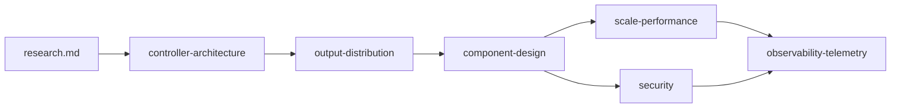

# Gateway API+ Control Plane — Design Index

This index tracks the **order of design work**, links each sub-document, and records **dependencies between topics**.

**Background:** [`research.md`](research.md) — consolidated research on Rust/kube-rs, resolved IR, policy attachment, Inference Extension, xDS, and HA. **Distribution** is generalized in [`output-distribution.md`](output-distribution.md): xDS is one backend, not the only way to ship IR.

**Implementation:** [`implementation-plan.md`](implementation-plan.md) — phased plan from scaffolding to conformance, merge points, and parallel lanes.

---

## Reading order

| Step | Document | Purpose |
|------|----------|---------|
| — | [`implementation-plan.md`](implementation-plan.md) | **Build order:** scaffolding → merge points → conformance; parallel lanes |
| 1 | [`controller-architecture.md`](controller-architecture.md) | End-to-end shape: watches → IR → **distribution**; HA, failure modes |
| 1b | [`dataplane-provisioning.md`](dataplane-provisioning.md) | Optional **provision** strategies; **xDS subscription scope** (all / one gateway); Praxis bootstrap |
| 2 | [`output-distribution.md`](output-distribution.md) | **Any output**: GatewayClass → output backends; xDS as one protocol among several |
| 3 | [`component-design.md`](component-design.md) | Reconciler, IR compiler, snapshot store, **output backend coordinator**, webhooks |
| 4 | [`scale-performance.md`](scale-performance.md) | Fan-out, incremental distribution, caching, debouncing, resource limits |
| 5 | [`security.md`](security.md) | RBAC, identities, TLS, distribution endpoints, policy constraints, supply chain |
| 6 | [`observability-telemetry.md`](observability-telemetry.md) | Metrics, tracing, logging, status surfaces, SLOs |

**Rationale:** Architecture and IR come first; **how IR is published** (multi-protocol) is explicit before component boundaries; scale, security, and observability then apply per backend and globally.

---

## Sub-task checklist

Use this as a living checklist during implementation.

### Phase A — Architecture frozen

- [ ] Document owner roles (who reconciles what CRDs)
- [ ] Confirm single vs multi-tenant deployment assumptions
- [ ] Decide leader-election vs active-active for **streaming** backends (e.g. xDS), if ever

### Phase B — Components specified

- [ ] IR schema/versioning strategy signed off
- [ ] **Output profile** model: GatewayClass / ParametersRef → backend id + options
- [ ] xDS backend: SotW vs Delta, ADS muxing (when xDS is enabled)
- [ ] Conversion webhook scope (which CRD transitions require it)

### Phase C — Scale validated

- [ ] Target cluster sizes and proxy counts stated
- [ ] Backpressure and queue bounds for reconcile and **each** active distribution backend

### Phase D — Security reviewed

- [ ] RBAC manifest reviewed against least privilege
- [ ] Threat model for **each** distribution surface (xDS, HTTP pull, K8s writes, …)

### Phase E — Observability ready for prod

- [ ] Metric names aligned with dashboards / alerts
- [ ] Status condition conventions documented for users

---

## Document map

---

## Related code (when present)

Update this section as packages land.

| Area | Package / directory |
|------|---------------------|
| Binary / wiring | `crates/ugwc` (`run.rs`, `config.rs`, `implementation_profiles.rs`) |
| xDS + scoped cache | `crates/ugwc-xds` (`cache.rs`, `server.rs`) |
| K8s provisioner | `crates/ugwc-k8s` (`provision/`) |
| Design | [`dataplane-provisioning.md`](dataplane-provisioning.md) |
