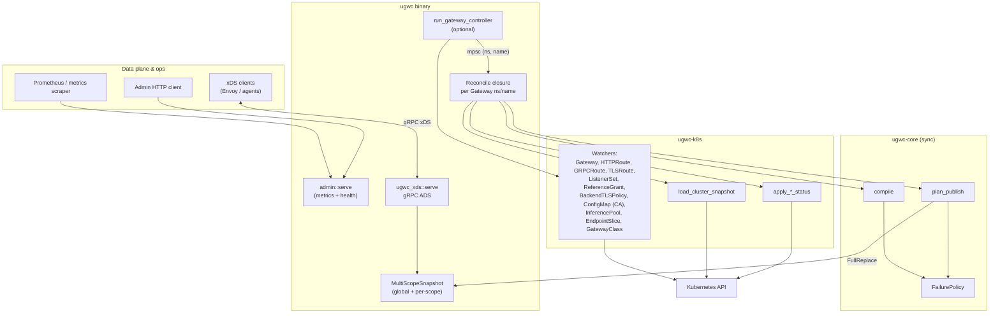
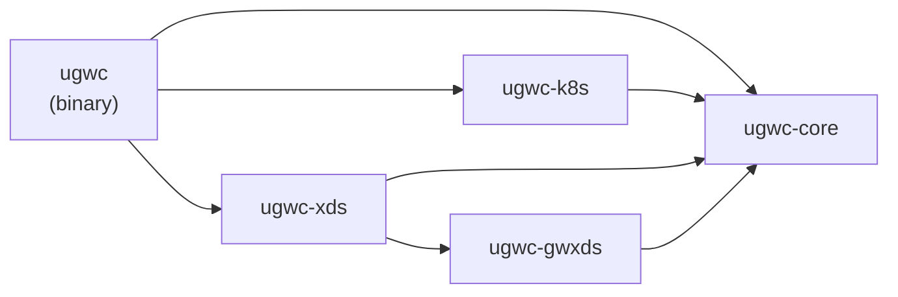
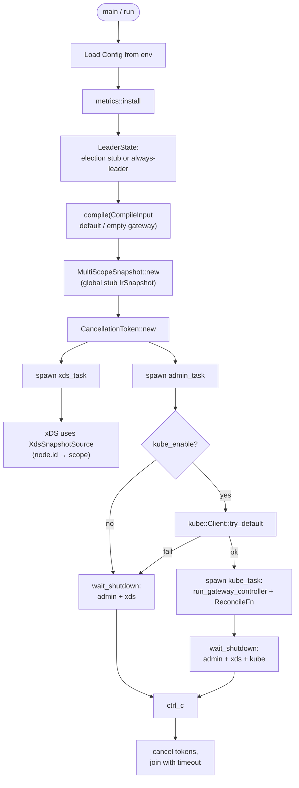
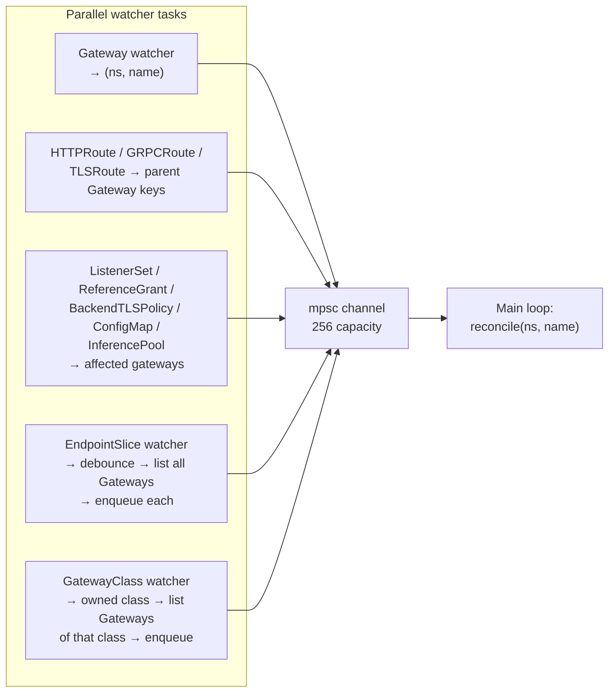
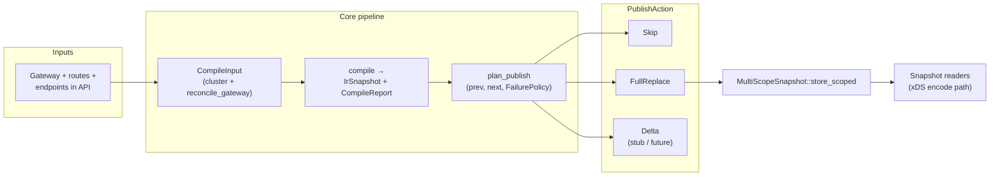

# Architecture

## Workspace

Rust workspace (`Cargo.toml` `[workspace]`) with these members:

| Crate | Role |
|-------|------|
| **ugwc** | Binary: CLI, config from environment, async runtime wiring (admin HTTP, xDS server, optional Kubernetes controller), leader/metrics hooks. |
| **ugwc-core** | Pure pipeline: cluster snapshot types, HTTP/Gateway-oriented IR, `compile`, `plan_publish`, `FailurePolicy` — **no** Kubernetes or xDS imports as the integration seam. |
| **ugwc-k8s** | `kube` / `kube-runtime`: watches, mappers from API objects into core inputs, status updates. |
| **ugwc-xds** | gRPC (tonic): ADS-style serving from a shared IR snapshot cache; security and wire options configured by the binary. |
| **ugwc-gwxds** | Encodes ugwc IR to `istio.gwxds` protobuf (build-time `prost`); used for Praxis-oriented distribution paths. |

## Gateway API compatibility

Target **Gateway API** bundle: **v1.5.x standard channel** (see [Gateway API releases](https://github.com/kubernetes-sigs/gateway-api/releases)). Install e.g. `standard-install.yaml` for the pinned minor; extended-channel installs must also include **`BackendTLSPolicy` `gateway.networking.k8s.io/v1`** if you use upstream TLS to Services. **Inference Extension:** install [`inference.networking.k8s.io`](https://gateway-api-inference-extension.sigs.k8s.io/guides/) CRDs when using `InferencePool` backends. ugwc focuses on `Gateway` / `HTTPRoute` / `GRPCRoute` / `TLSRoute` / `ListenerSet` / `ReferenceGrant`, with HTTPS listeners terminating TLS using `listener.tls.certificateRefs` → `Secret` (`tls.crt` / `tls.key`), optional `Gateway.spec.addresses` validation, and `Gateway.spec.infrastructure.labels` merged into per-gateway Praxis workload labels.

**Backend TLS:** `BackendTLSPolicy` objects (same namespace as target `Service`) are listed for namespaces of backend Services needed by attached routes. Validation material (`ca.crt` on referenced `ConfigMap`s, or `wellKnownCACertificates: System`) is resolved at snapshot load time and attached per backend (`namespace/name:port`) on the compiled IR; `ugwc-gwxds` maps this to `Backend.tls`. Conflicting policies or bad CA refs surface on policy **ancestor** status toward each reconciled `Gateway` and as **`ResolvedRefs`** errors on affected routes when compilation fails closed.

## Diagrams

### Logical components

Process boundary is the **`ugwc` binary**. It hosts long-lived Tokio tasks; **ugwc-core** has no async runtime of its own — it is invoked synchronously from those tasks.



### Crate dependency graph



`ugwc-gwxds` implements IR → `istio.gwxds` protobuf encoding; the **`ugwc` binary pulls it in transitively** via `ugwc-xds`.

### Runtime: startup and concurrent tasks



### Kubernetes controller: watch fan-in

Several parallel watchers enqueue the same reconcile key `(namespace, gateway_name)`. A single consumer loop `recv`s keys and invokes the shared **`ReconcileFn`**.



### Reconcile sequence (per Gateway)

This matches the closure wired in `ugwc::run`: load snapshot → compile → plan → status patches → optional cache update.

```mermaid
sequenceDiagram
    participant Loop as controller main loop
    participant API as Kubernetes API
    participant Load as ugwc_k8s::load_cluster_snapshot
    participant Core as ugwc_core::compile
    participant Plan as plan_publish
    participant Cache as MultiScopeSnapshot
    participant St as status writers
    participant Xds as xDS server tasks

    Loop->>API: GET Gateway (latest)
    Loop->>Load: load_cluster_snapshot(client, ns, name)
    Load->>API: list/get related objects
    Load-->>Loop: ClusterSnapshot or None
    Loop->>Core: compile(FailurePolicy, CompileInput)
    Core-->>Loop: CompileOutcome (report + IrSnapshot)
    alt not leader
        Loop-->>Loop: skip publish status provision
    else leader
        Loop->>Cache: previous_for_scope(next.scope)
        Loop->>Plan: plan_publish(prev, next, policy)
        Plan-->>Loop: PublishPlan (action)
        Loop->>St: apply_gateway_reconciled_status
        Loop->>St: apply_http_route_parent_status (per route)
        Loop->>St: apply_backend_tls_policies_for_gateway
        St->>API: PATCH status subresources
        alt PublishAction::FullReplace
            Loop->>Cache: store_scoped(new IrSnapshot)
        end
        Note over Loop: optional dataplane provision (profile)
    end
    Note over Cache,Xds: xDS resolves node.id to per-scope or global snapshot
```

### Compile → publish → cache → xDS (data flow)



## Runtime shape

At a high level:

1. **Startup** — Load config, initialize logging/metrics, optionally elect or assume leader (stub paths exist).
2. **IR cache** — `MultiScopeSnapshot`: a global snapshot plus per-gateway keys; xDS selects by `node.id`.
3. **Compile loop** — Core `compile` consumes `CompileInput` (from fixtures, tests, or cluster-derived snapshots) and produces `CompileOutcome` + snapshot.
4. **Publish planning** — `plan_publish` compares previous and next snapshots with `FailurePolicy` to decide actions (full replace, skip, etc.).
5. **Kubernetes path** (when enabled) — Controller reconciles Gateway (and related) objects, feeds the compiler, updates shared cache and status.
6. **xDS path** — Server streams encoded resources from the cache to connected proxies.

Admin and Prometheus endpoints run alongside these services for health and observability.

## Layering rules

- **ugwc-core** stays the place for deterministic, testable transforms: IR types, compile reports, publish plans.
- **ugwc-k8s** translates API machinery into what core expects; it does not reimplement routing semantics that belong in core.
- **ugwc-xds** maps IR to xDS wire messages; Envoy-specific structs are not the IR itself.

## Related material

Design rationale and phased delivery: [design.md](design.md), and [`../design/`](../design/) for longer-form notes.
