# Architecture

## Workspace

Rust workspace (`Cargo.toml` `[workspace]`) with these members:

| Crate | Role |
|-------|------|
| **ugwc** | Binary: CLI, config from environment, async runtime wiring (admin HTTP, xDS server, optional Kubernetes controller), leader/metrics hooks. |
| **ugwc-core** | Pure pipeline: cluster snapshot types, HTTP/Gateway-oriented IR, `compile`, `plan_publish`, `FailurePolicy` — **no** Kubernetes or xDS imports as the integration seam. |
| **ugwc-k8s** | `kube` / `kube-runtime`: watches, mappers from API objects into core inputs, status updates. |
| **ugwc-xds** | gRPC (tonic): ADS-style serving from a shared IR snapshot cache; security and wire options configured by the binary. |
| **ugwc-gwxds** | Encodes ugwc IR to `istio.gwxds` protobuf (build-time `prost`); used for Praxis-oriented distribution paths. |

## Gateway API compatibility

Target **Gateway API** bundle: **v1.5.x standard channel** for core v1 resources (see [Gateway API releases](https://github.com/kubernetes-sigs/gateway-api/releases)). Install e.g. `standard-install.yaml` for the pinned minor.

- **Standard channel:** `Gateway`, `GatewayClass`, `HTTPRoute`, `GRPCRoute`, `TLSRoute`, `ListenerSet`, `ReferenceGrant`, and related v1 types ugwc reconciles (HTTPS listeners terminating TLS via `listener.tls.certificateRefs` → `Secret` with `tls.crt` / `tls.key`; optional `Gateway.spec.addresses`; `Gateway.spec.infrastructure.labels` merged into per-gateway Praxis workload labels).
- **Experimental Gateway API CRDs:** **`TCPRoute`** and **`UDPRoute`** (`gateway.networking.k8s.io/v1alpha2`) require the **experimental** install bundle (`experimental-install.yaml` or equivalent). If those CRDs are missing, ugwc logs and skips listing those types.
- **Backend TLS:** extended-channel installs must include **`BackendTLSPolicy`** **`gateway.networking.k8s.io/v1`** when using upstream TLS to Services / InferencePools per policy.
- **Inference Extension:** install [`inference.networking.k8s.io`](https://gateway-api-inference-extension.sigs.k8s.io/guides/) CRDs when using **`InferencePool`** backends.

Operator install order and env summaries: [operations.md](operations.md).

**ReferenceGrant:** Cross-namespace references require grants in the **referenced resource namespace** — attachment of routes from namespace A to a `Gateway` or attached `ListenerSet` in namespace B, `Service` / `InferencePool` backends, and cross-namespace TLS `Secret` refs on listeners are enforced during snapshot load / compile. The `ReferenceGrant` watcher enqueues gateways in the grant’s namespace plus gateways referenced by routes living in each `spec.from[].namespace` (cluster-wide route listing remains the fallback when `from` is empty). Grant fan-out for routes still uses live API listing today; the reverse index covers EndpointSlice, Secret, and ConfigMap backend churn only.

**Backend TLS:** `BackendTLSPolicy` objects are listed for namespaces of backend resources needed by attached routes (see below). Validation material is resolved at snapshot load time and attached on the compiled IR; **Service** backends use snapshot keys `namespace/name:servicePort`, **InferencePool** backends use `inferencepool/namespace/name:targetPort`. `ugwc-gwxds` maps this to `Backend.tls` (including optional client certificate material for backend mTLS). Conflicting policies or bad refs surface on policy **ancestor** status toward each reconciled `Gateway` and as **`ResolvedRefs`** errors on affected routes when compilation fails closed.

**BackendTLSPolicy limitations (operator-facing):**

1. **Targets:** Core path is **`Service`** `targetRefs` in the **same namespace** as the policy. **`InferencePool`** targets are also supported when those pools are referenced as backends on routes for this Gateway. Other `targetRef` kinds are ignored until explicitly implemented.
2. **CA / trust:** **`caCertificateRefs`** — `ConfigMap` (`ca.crt`) and **`Secret`** (`ca.crt`, or `tls.crt` as a PEM certificate bundle) in the policy namespace, or **cross-namespace** when a **`ReferenceGrant`** in the CA resource namespace allows `from: kind BackendTLSPolicy, namespace: <policy ns>` to `to: kind ConfigMap|Secret` (name optional/wildcard per grant rules). **`wellKnownCACertificates: System`** is supported; other well-known values are rejected unless added explicitly.
3. **Client certificate:** Optional **`clientCertificateRefs`** on the policy (`Secret` with `tls.crt` / `tls.key`, same-namespace or cross-namespace via **`ReferenceGrant`** with `to: Secret`) populate upstream mTLS identity in IR/xDS.
4. **Route coverage:** Backend Services referenced only from **HTTPRoute**/**GRPCRoute** rule **`filters`** (**RequestMirror**, **ExternalAuth**) or nested **`backendRefs[].filters`** are included in snapshot loading and in **`BackendTLSPolicy` → Gateway reconcile** fan-out (same as rule-level `backendRefs`).
5. **`spec.options`:** Not forwarded to the dataplane yet.

## Compatibility pins

Best-effort reference for support expectations (CI and manual tests track Gateway API **v1.5.x** standard + experimental where coded). Exact pins should converge with release notes over time.

| Axis | Pin / note |
|------|------------|
| **ugwc** | Workspace version (e.g. `0.1.0` in root `Cargo.toml`) or `main` at a given commit — treat as development until release tagging is formalized. |
| **Gateway API** | Standard **v1.5.x** for ListenerSet and core v1 routes; **experimental** bundle for **TCPRoute** / **UDPRoute** (`v1alpha2`). |
| **Inference Extension** | Release **`manifests.yaml`** from [gateway-api-inference-extension releases](https://github.com/kubernetes-sigs/gateway-api-inference-extension/releases) when using **InferencePool** — pin a tag in your fleet docs. |
| **Dataplane** | Implementation-specific (e.g. Praxis / Envoy build that speaks `gwxds`); not pinned in-repo. |

## Diagrams

### Logical components

Process boundary is the **`ugwc` binary**. It hosts long-lived Tokio tasks; **ugwc-core** has no async runtime of its own — it is invoked synchronously from those tasks.

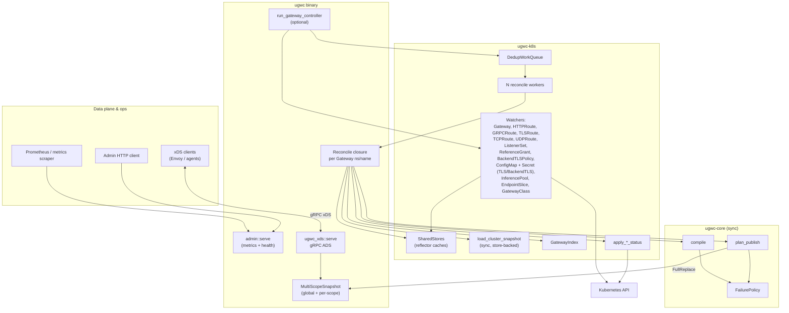

### Crate dependency graph

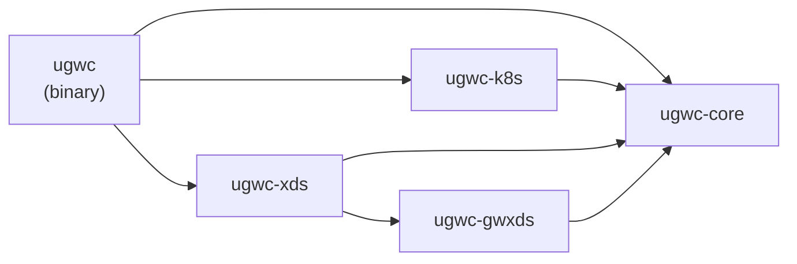

`ugwc-gwxds` implements IR → `istio.gwxds` protobuf encoding; the **`ugwc` binary pulls it in transitively** via `ugwc-xds`.

### Runtime: startup and concurrent tasks

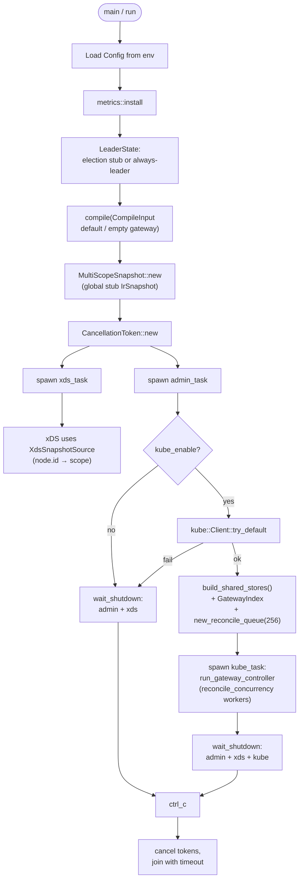

### Compile → publish → cache → xDS (data flow)

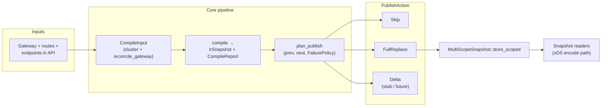

## Reconcile pipeline

When `UGWC_KUBE_ENABLE=true`, the Kubernetes controller uses reflector-backed stores, a deduplicating workqueue, concurrent reconcile workers, a reverse index for targeted fan-out, and bounded parallel status patches. See [operations.md](operations.md) for `UGWC_RECONCILE_CONCURRENCY`, `UGWC_STATUS_PATCH_CONCURRENCY`, and `UGWC_ENDPOINT_DEBOUNCE_MS`.

### End-to-end overview

Watch streams populate in-memory stores. Watcher events resolve to gateway keys `(namespace, name)` and enter a dedup queue. `N` workers dequeue keys and run the reconcile closure: synchronous snapshot load from stores, compile, gateway status patch, then parallel attached-resource status patches.

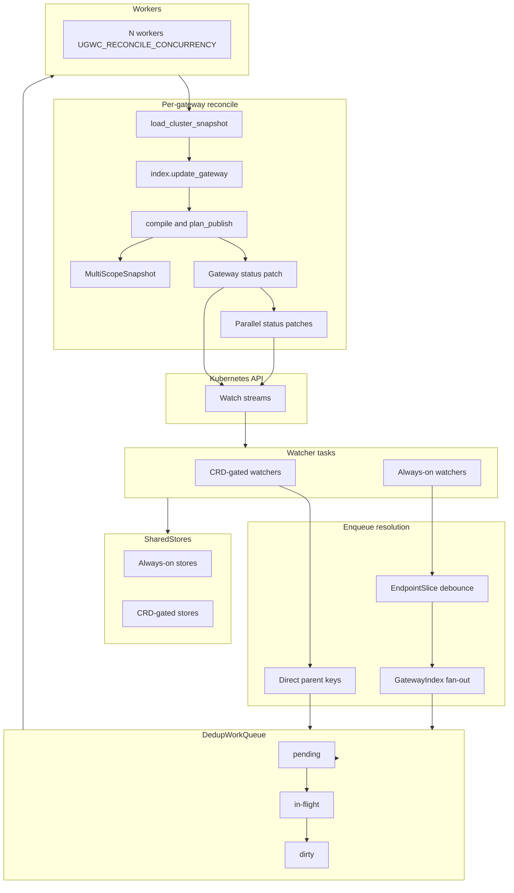

### Reflector stores

Always-on watches (EndpointSlice, Service, Secret, ConfigMap, Namespace) create stores at controller startup via `build_shared_stores()`. CRD-gated watches (Gateway, routes, policies, classes) register stores when the CRD supervisor starts the corresponding watcher and clear them when the CRD is removed. `load_cluster_snapshot` reads synchronously from `SharedStores`; it does not call the API during reconcile.

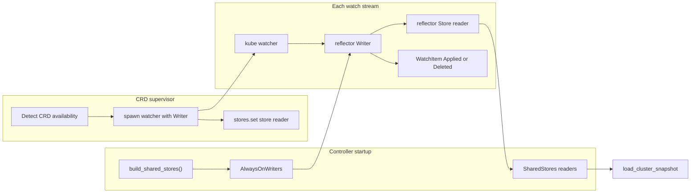

Status patches and optional dataplane provisioning still use `kube::Client`. Only snapshot **reads** are store-backed.

### Enqueue and fan-out

Gateway, route, and policy watchers enqueue parent gateway keys directly. EndpointSlice events are debounced (`UGWC_ENDPOINT_DEBOUNCE_MS`), then resolved through `GatewayIndex` by service name. Secret and ConfigMap events use the same index pattern.

Before every gateway has reconciled once, index misses fall back to store-backed broad fan-out. After the index is fully populated, a miss on an indexed event kind enqueues nothing (no thundering herd for unrelated objects).

**Hybrid fan-out:** EndpointSlice, Secret, and ConfigMap use `GatewayIndex`. Route, ReferenceGrant, GatewayClass, BackendTLSPolicy, and InferencePool watchers still resolve fan-out keys via live API calls in `watch_enqueue.rs`. Managed per-gateway Services enqueue one gateway directly via label lookup.

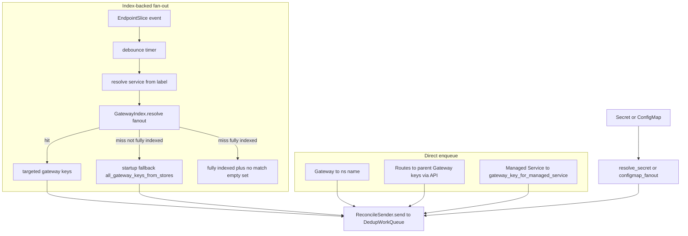

### Dedup queue state machine

The queue implements client-go workqueue semantics. Duplicate enqueues while a key is pending are dropped (`ugwc_workqueue_dedup_total`). Re-enqueues while in-flight set a dirty bit; `done()` moves the key back to pending once (`ugwc_workqueue_retries_total`). The same gateway is never reconciled by two workers simultaneously.

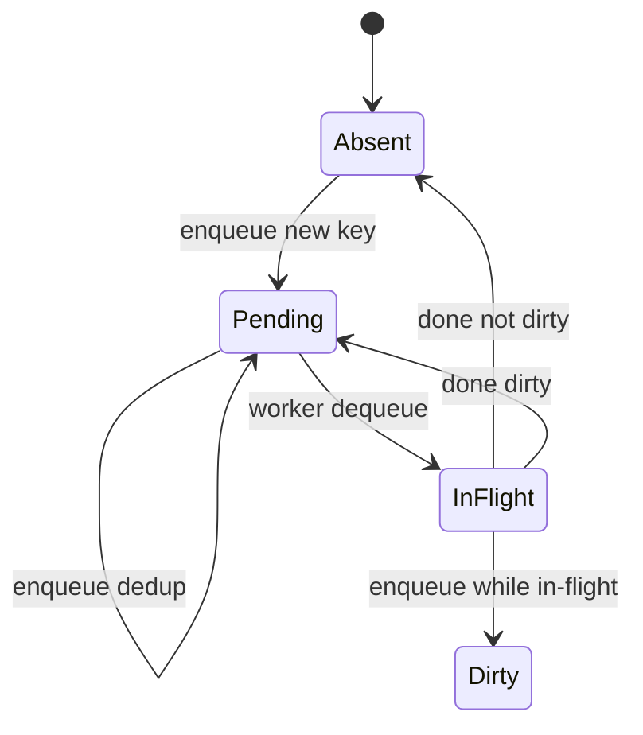

### Concurrent workers

`run_gateway_controller` spawns a `JoinSet` of `UGWC_RECONCILE_CONCURRENCY` workers. Each worker loops: `recv` → `begin_reconcile` → `reconcile(ns, name)` → `end_reconcile` → `done(ns, name)`.

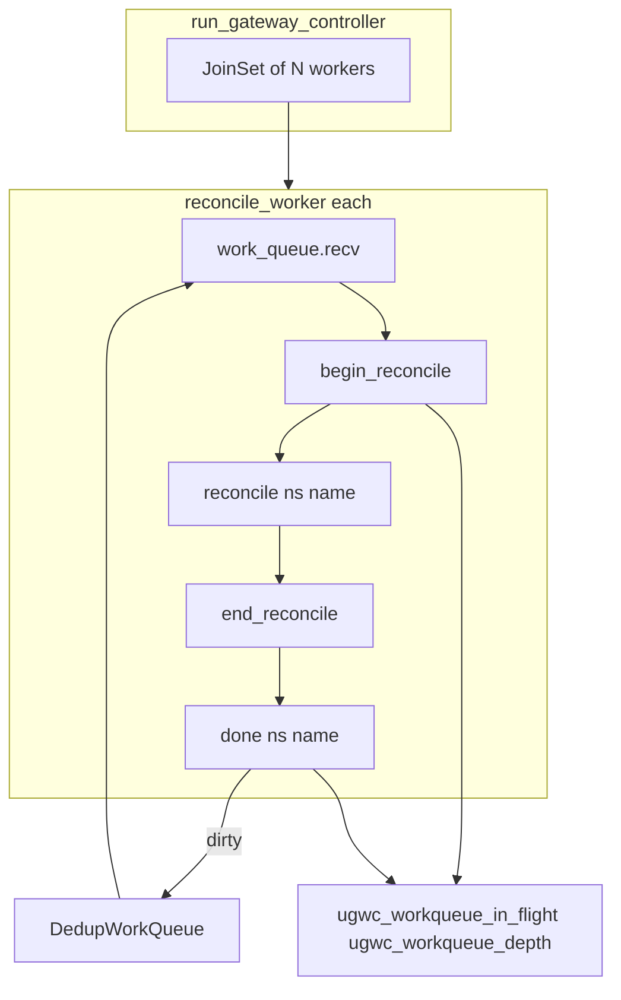

### Single reconcile sequence

This matches the closure wired in `ugwc::run`. Gateway status is patched first; route, ListenerSet, BackendTLSPolicy, and InferencePool status patches run in parallel up to `UGWC_STATUS_PATCH_CONCURRENCY`.

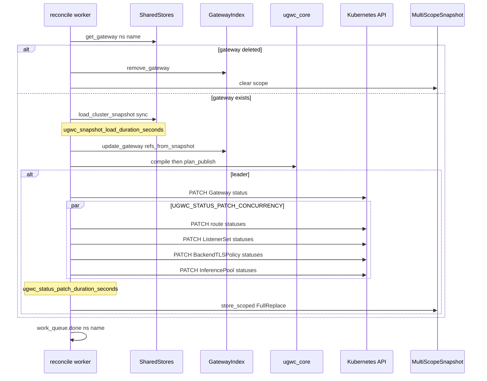

### Startup readiness

`/readyz` opens when `InitialSyncGate` completes: CRD supervisor initial list **and** EndpointSlice reflector store ready (`wait_until_ready`). There is no standalone Gateway list gate; Gateway and route stores populate as CRD-gated watchers start.

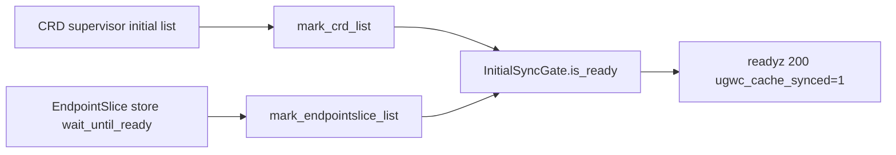

## Runtime shape

At a high level:

1. **Startup** — Load config, initialize logging/metrics, optionally elect leader via Kubernetes `Lease` (or assume leader when election is off). `/readyz` stays **503** until `InitialSyncGate` completes: CRD initial list and EndpointSlice reflector store ready (`ugwc_cache_synced=1`). Gateway and route stores populate asynchronously as the CRD supervisor starts watchers.
2. **IR cache** — `MultiScopeSnapshot`: a global snapshot plus per-gateway keys; xDS selects by `node.id`.
3. **Compile loop** — Core `compile` consumes `CompileInput` (from fixtures, tests, or cluster-derived snapshots) and produces `CompileOutcome` + snapshot.
4. **Publish planning** — `plan_publish` compares previous and next snapshots with `FailurePolicy` to decide actions (full replace, skip, etc.).
5. **Kubernetes path** (when enabled) — Dedup workqueue and `UGWC_RECONCILE_CONCURRENCY` workers reconcile gateways concurrently. Snapshot load reads reflector stores (no API lists per reconcile). `GatewayIndex` targets EndpointSlice/Secret/ConfigMap fan-out. Status patches run in parallel up to `UGWC_STATUS_PATCH_CONCURRENCY`. See [Reconcile pipeline](#reconcile-pipeline).
6. **xDS path** — Server streams encoded resources from the cache to connected proxies.

Admin and Prometheus endpoints run alongside these services for health and observability. On shutdown (SIGTERM/Ctrl-C), readiness clears first, in-flight reconciles drain (up to ~30s), then watches and servers stop. See [observability.md](observability.md).

## Layering rules

- **ugwc-core** stays the place for deterministic, testable transforms: IR types, compile reports, publish plans.
- **ugwc-k8s** translates API machinery into what core expects; it does not reimplement routing semantics that belong in core.
- **ugwc-xds** maps IR to xDS wire messages; Envoy-specific structs are not the IR itself.

## Related material

Design rationale and phased delivery: [design.md](design.md), [operations.md](operations.md), [observability.md](observability.md), and [`../design/`](../design/) for longer-form notes.
